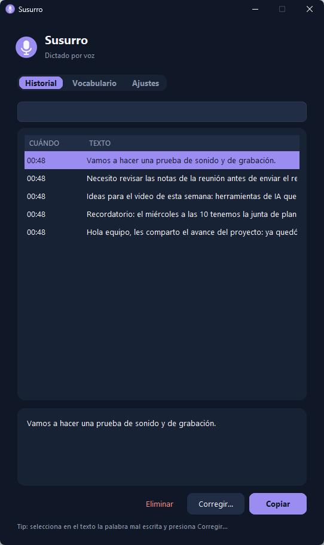
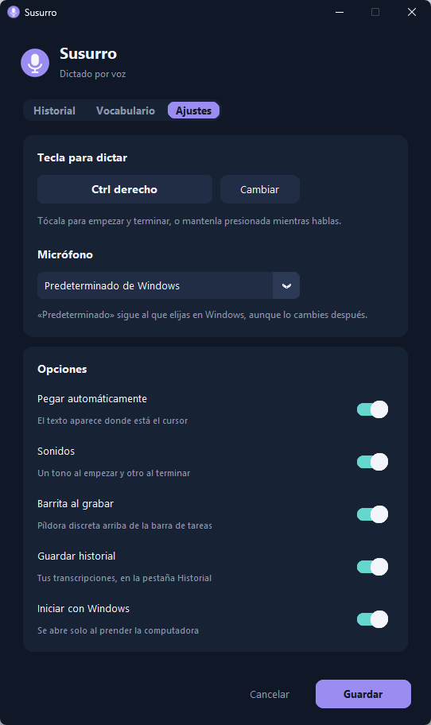

# 🎙️ Susurro

**Dictado por voz para Windows, 100% local.** Tocas una tecla, hablas, y el texto aparece donde está tu cursor, en cualquier aplicación. Usa [Whisper](https://github.com/openai/whisper) de OpenAI corriendo **en tu propia computadora**: gratis, sin cuentas, y tu voz nunca sale de tu PC.

🌐 **Sitio web y más información: [susurro.hieloco.de](https://susurro.hieloco.de)**

<p align="center">
  
  
</p>

## ✨ Qué hace

- **Dicta en cualquier app.** Word, Gmail, WhatsApp Web, Notion, tu editor de código… El texto se pega solo donde está el cursor y además queda copiado para pegarlo con `Ctrl+V` donde quieras.
- **Una sola tecla, dos formas de usarla** (por defecto **Ctrl derecho**, configurable):
  - **Tocar:** empieza a grabar; otro toque termina.
  - **Mantener presionada:** graba mientras la sostienes; al soltar, transcribe.
  - **Esc** cancela sin pegar nada.
- **Píldora discreta** arriba de la barra de tareas mientras grabas, con el volumen de tu voz y el tiempo:

  

- **Historial** de tus últimas 1,000 transcripciones, con buscador. Las 10 más recientes también están en el menú del ícono, para copiarlas con un clic.
- **Vocabulario personalizado** para que escriba bien nombres y términos técnicos (nombres de clientes, marcas, términos de tu trabajo…), más **reemplazos** automáticos. Desde el historial puedes **corregir** una palabra y Susurro la aprende.
- **Filtro de "frases fantasma":** quita las frases que Whisper a veces inventa con silencio o ruido (*"Subtítulos realizados por la comunidad de Amara.org"*, *"¡Gracias por ver el video!"*…).
- **Elige el micrófono**, o deja que siga al predeterminado de Windows aunque lo cambies.
- Rápido: con una GPU NVIDIA, un dictado de 30 segundos se transcribe en ~2-3 segundos.

## 💻 Requisitos

| | Mínimo | Recomendado |
|---|---|---|
| **Sistema** | Windows 10 u 11 | Windows 11 |
| **Python** | 3.10 – 3.13 | **3.12** (con el que se probó) |
| **Tarjeta de video** | No es obligatoria | **NVIDIA con 4 GB+ de VRAM** |
| **Disco** | ~2.5 GB | ~3.5 GB con GPU |
| **Micrófono** | Cualquiera | |
| **Internet** | Solo durante la instalación | |

> **¿Y sin tarjeta NVIDIA?** Funciona con el procesador, pero es mucho más lento: cada dictado tarda **más o menos lo mismo que lo que hablaste** (en un procesador de escritorio: 38 s de audio → ~38 s). Con GPU NVIDIA, esos mismos 38 s tardan ~3 s.

## 🧠 El modelo de IA

Susurro usa **un solo modelo**, y el instalador lo descarga solo. **No necesitas Ollama, LM Studio ni ninguna otra IA.**

| | |
|---|---|
| **Modelo** | Whisper **large-v3-turbo** (OpenAI), en el formato optimizado de [faster-whisper](https://github.com/SYSTRAN/faster-whisper) / CTranslate2 |
| **Descarga** | Automática desde Hugging Face ([`mobiuslabsgmbh/faster-whisper-large-v3-turbo`](https://huggingface.co/mobiuslabsgmbh/faster-whisper-large-v3-turbo)), **~1.6 GB**, una sola vez |
| **Dónde queda** | `%USERPROFILE%\.cache\huggingface\hub\` |
| **Memoria de video** | ~2 GB en GPU |
| **Idioma** | Español (configurable en `susurro.py` → `LANGUAGE`) |

**¿Por qué este modelo?** Se comparó contra `large-v3` (el "grande") dictando en español: turbo transcribió 38 s de audio en **3.2 s** contra **12.8 s** del grande, con la misma precisión. Los modelos chicos (`small`, `medium`) escriben notablemente peor y casi no son más rápidos en CPU.

## 📦 Instalación

### ⚡ Rápida (recomendada): un solo comando

Abre **PowerShell** (tecla Windows → escribe *PowerShell* → Enter), pega esto y presiona Enter:

```powershell
irm https://susurro.hieloco.de/install.ps1 | iex
```

Se encarga de todo: instala Python 3.12 si no lo tienes (con `winget`), descarga Susurro en `%LOCALAPPDATA%\Susurro` y lo deja listo con accesos directos. **Para actualizar, vuelve a correr el mismo comando**: conserva tu configuración y tu historial.

> ¿Prefieres revisar el script antes de ejecutarlo? Está aquí: [`install.ps1`](install.ps1). Si tu antivirus bloquea el comando, usa la instalación con ZIP de abajo.

### 📁 Con ZIP

1. **Instala Python 3.12** desde [python.org](https://www.python.org/downloads/). En el instalador marca la casilla **"Add python.exe to PATH"**.
2. **Descarga Susurro:** botón verde **Code → Download ZIP** y descomprímelo donde quieras que viva (por ejemplo `C:\Programas\Susurro`). O con Git:
   ```bash
   git clone https://github.com/davidhielo91/susurro.git
   ```
3. **Doble clic en `instalar.bat`.** El instalador:
   1. busca Python,
   2. crea un entorno aislado (`.venv`) dentro de la carpeta, sin tocar tu sistema,
   3. instala las dependencias,
   4. si tienes NVIDIA, instala las librerías de CUDA (no necesitas instalar CUDA aparte),
   5. descarga el modelo de Whisper,
   6. crea el acceso directo **Susurro** en el escritorio y en el inicio de Windows,
   7. abre Susurro.

La primera vez tarda unos minutos por las descargas (~3 GB con GPU). Al abrir, Susurro tarda **~20 segundos** en cargar el modelo; cuando el ícono del micrófono en la bandeja se pone **lavanda**, ya está listo.

<details>
<summary><b>Instalación manual (si prefieres hacerlo paso a paso)</b></summary>

```powershell
cd C:\ruta\a\susurro
py -3.12 -m venv .venv
.venv\Scripts\python -m pip install -r requirements.txt
.venv\Scripts\python -m pip install -r requirements-gpu.txt   # solo con NVIDIA
.venv\Scripts\python susurro.py --descargar-modelo
.venv\Scripts\python susurro.py --crear-accesos
.venv\Scripts\pythonw susurro.py
```
</details>

## 🗣️ Uso

1. Pon el cursor donde quieras escribir.
2. **Toca Ctrl derecho** (suena un tono agudo y aparece la píldora) y habla.
3. **Toca Ctrl derecho otra vez** (tono grave). En un par de segundos el texto aparece.

**El ícono de la bandeja** (junto al reloj) cambia de color según el estado: lavanda = listo, turquesa = grabando, azul noche = transcribiendo, gris = cargando.

- **Doble clic** en el ícono, o abrir el acceso directo otra vez: abre la ventana de Susurro.
- **Clic derecho:** últimas 10 transcripciones (clic = copiar), grabar/detener, sitio web y salir.

**La ventana tiene tres pestañas:**

| Pestaña | Para qué |
|---|---|
| **Historial** | Buscar, copiar, eliminar o **corregir** transcripciones. Corregir agrega la palabra al vocabulario. |
| **Vocabulario** | Palabras que usas seguido y reemplazos automáticos (*"chat gpt" → "ChatGPT"*). |
| **Ajustes** | Tecla de dictado, micrófono, pegar automáticamente, sonidos, píldora, historial e inicio con Windows. |

> **Consejo de tecla:** en teclados latinoamericanos el Alt derecho es **AltGr** (el de la `@`). Susurro solo reacciona si lo tocas **solo**, así que AltGr + Q sigue escribiendo `@`.

## 🔒 Privacidad y archivos

Todo se procesa en tu computadora. La única conexión a internet es para descargar las dependencias y el modelo al instalar.

| Archivo (en la carpeta de Susurro) | Contenido |
|---|---|
| `config.json` | Tus ajustes, vocabulario y reemplazos |
| `historial.json` | Tus transcripciones (puedes desactivarlo en Ajustes) |
| `susurro.log` | Registro para diagnosticar problemas; se recorta solo |

Ninguno se sube a Git (están en `.gitignore`). **Para respaldar o pasar Susurro a otra PC, copia `config.json` e `historial.json`.**

## 🛠️ Solución de problemas

| Problema | Solución |
|---|---|
| No se pega en cierta app | Si esa app corre **como administrador**, Windows no deja que otros programas le escriban. Usa `Ctrl+V`: el texto ya está copiado. |
| No escribe nada / sale vacío | Revisa el micrófono en **Configuración de Windows → Sistema → Sonido → Micrófono → Iniciar prueba** y sube el volumen de entrada. `susurro.log` muestra el "nivel máximo" de cada grabación (al hablar debería ser 0.3 o más). |
| Escribe mal un nombre | Agrégalo en **Vocabulario**, o usa **Corregir…** en el Historial. |
| Tarda mucho | Sin GPU NVIDIA es normal (ver Requisitos). Con NVIDIA, revisa en `susurro.log` que diga *"cargado en GPU"*. |
| El ícono del escritorio se ve viejo | Es caché de íconos de Windows: presiona `F5` en el escritorio o reinicia. |
| Quiero dictar en otro idioma | Cambia `LANGUAGE = "es"` en `susurro.py` (o `None` para detectarlo solo). |

## 🗑️ Desinstalar

1. Clic derecho en el ícono de la bandeja → **Salir**.
2. Borra la carpeta de Susurro y los accesos directos `Susurro` del escritorio y de `shell:startup` (escríbelo en la barra de direcciones del Explorador).
3. Opcional: borra el modelo en `%USERPROFILE%\.cache\huggingface\hub\models--mobiuslabsgmbh--faster-whisper-large-v3-turbo` (~1.6 GB).

## 🙏 Créditos

- [Whisper](https://github.com/openai/whisper) de OpenAI: el modelo de reconocimiento de voz (licencia MIT).
- [faster-whisper](https://github.com/SYSTRAN/faster-whisper) y [CTranslate2](https://github.com/OpenNMT/CTranslate2): la ejecución rápida en GPU/CPU.
- [CustomTkinter](https://github.com/TomSchimansky/CustomTkinter): la interfaz.
- [pystray](https://github.com/moses-palmer/pystray), [keyboard](https://github.com/boppreh/keyboard), [sounddevice](https://github.com/spatialaudio/python-sounddevice).

## 🌐 Más información

Novedades, guías y contacto en **[susurro.hieloco.de](https://susurro.hieloco.de)**.

## 📄 Licencia

[MIT](LICENSE) © 2026 David Hielo
